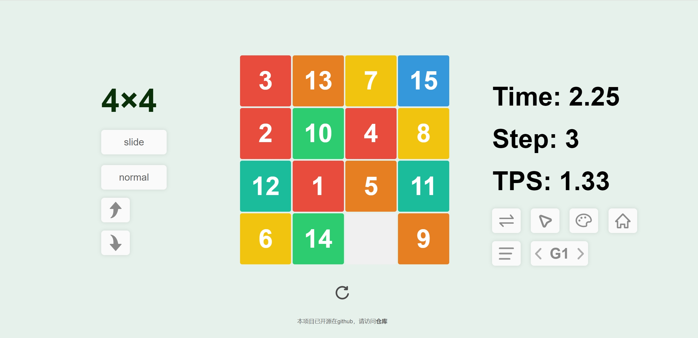
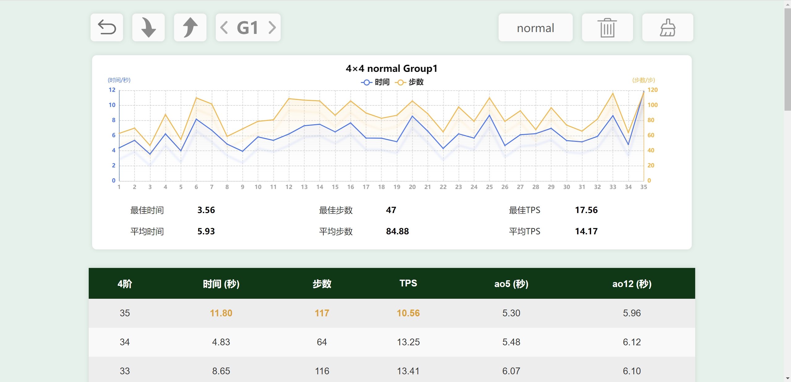
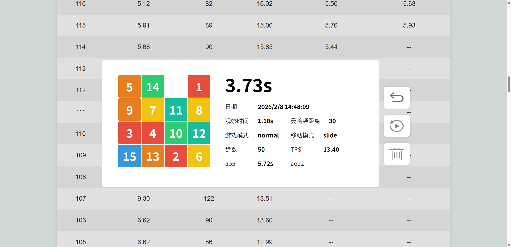

# 简介

此仓库是个人博客，但是没什么内容好写，就做了点小游戏：

- 🧩 数字华容道

> 贪吃蛇已下线；后续新游戏会按 [`docs/GAMES.md`](./docs/GAMES.md) 的统一约定接入。
>
> 当前 `refactor/vite-ts` 分支正在从零重构。拼图游戏页、设置页、游戏主题列表与主题编辑器已完成并手动验收（2026-10-27），可正常游玩、保存成绩与录像、重玩同一打乱、切换事件内分组；P8-4c-2c 当前阶数回退提示和 P8-5a 极简计时已实现（2026-10-27），待手动验收；移动端横屏暂缓；成绩页、回放页仍在迁移中。以下功能说明暂时保留作为行为参考。

# 访问地址

网页部署使用Github Pages和Netlify两种，二者内容相同，用户本地数据不互通；

Github Pages: https://criel14.github.io/

Netlify (国内直接访问) : https://criel-puzzle-game.netlify.app/

# 本地开发

需要 Node.js 22+ 和 npm。

```bash
npm install
npm run dev
```

常用命令：

- `npm run build`：类型检查并构建到 `dist/`
- `npm run preview`：预览构建结果
- `npm run typecheck`：TypeScript 类型检查
- `npm run lint`：ESLint 检查
- `npm run format` / `npm run format:check`：Prettier 格式化/检查

<br>

# Puzzle Game 数字华容道

## 简介

这是一个数字华容道游戏，一般称作"15Puzzle"（即4×4的华容道有15个块），但本项目包含了2×2到10×10一共9种难度；

比较有意思的有2点：如何判断打乱是否有解？如何配置颜色？详见：[数字华容道详细介绍](./docs/PUZZLE_GAME.md)

## 功能一览

- 🕹️ 操作模式：滑动 / 点击 / 键盘
- 🎮 游戏模式：正常模式 / 盲玩模式
- 🔃 刷新打乱
- 📏 阶数调整：2×2 ➡️ 10×10
- 🎨 个性化：自定义外观（文字大小 / 圆角 / 间距）、保存预设、更明显的鼠标指针、极简UI切换
- 📊 实时统计：游戏时间、移动步数、TPS
- 🧮 成绩统计：分组选择，分组最佳/平均（时间/步数/TPS）、平均观察时间、5/12 连复原平均、统计折线图、单次成绩
- 🎥 录像回放：倍速播放、录像重玩

## 页面展示

### 游戏页



### 成绩列表页



### 成绩详细页



<br>

# 反馈

> tips：此项目纯娱乐，随缘更新

如有疑问或建议，请联系chencriel@qq.com

# 支持我

如果对你有帮助，我非常荣幸，玩得开心！你的[支持](https://github.com/Criel14/Criel14.github.io/blob/main/docs/images/wechat-pay.jpg)是我进步的动力。
